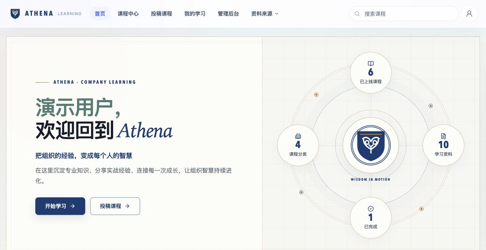
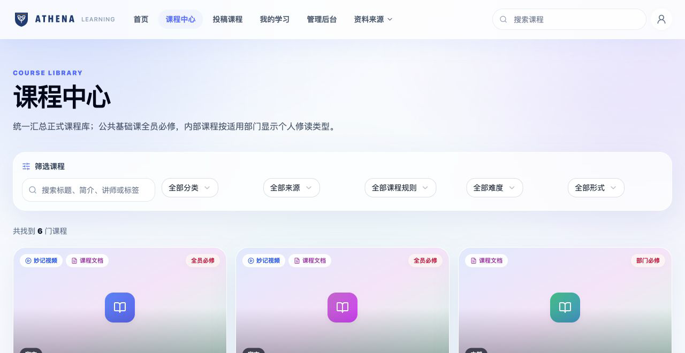
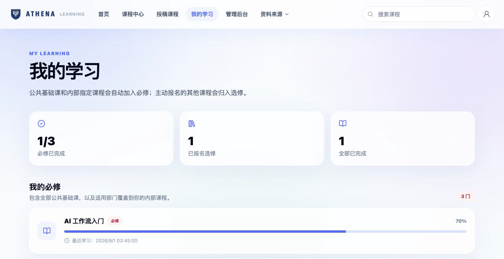
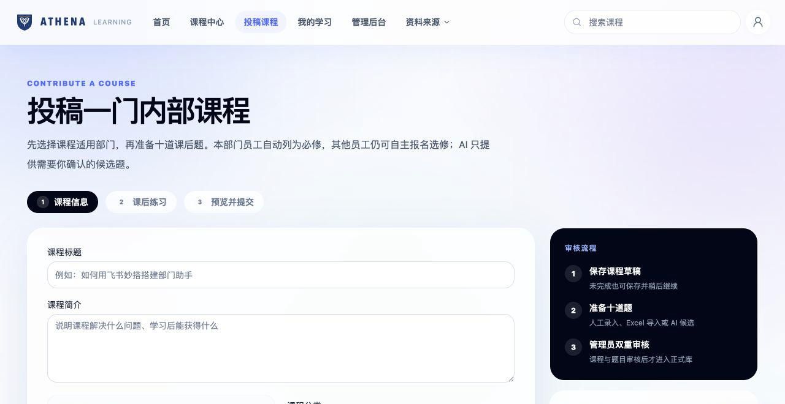
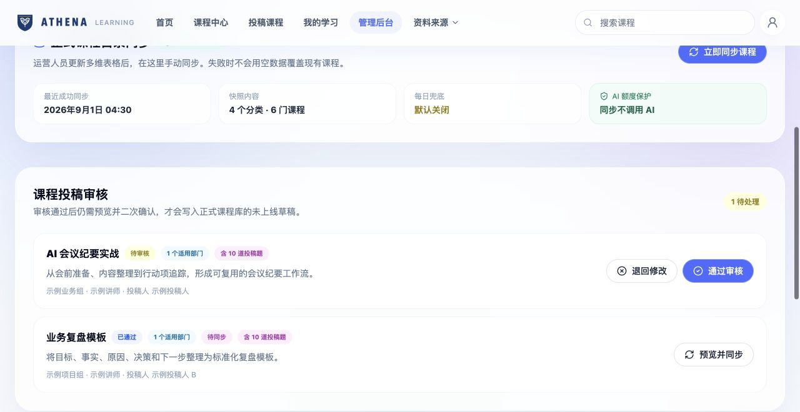
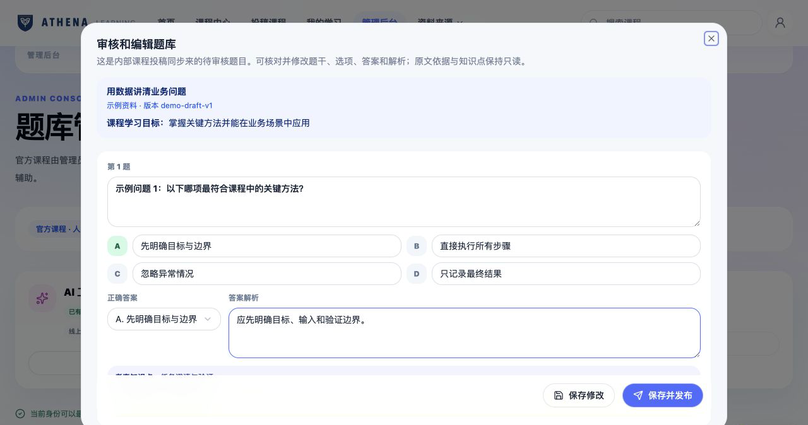
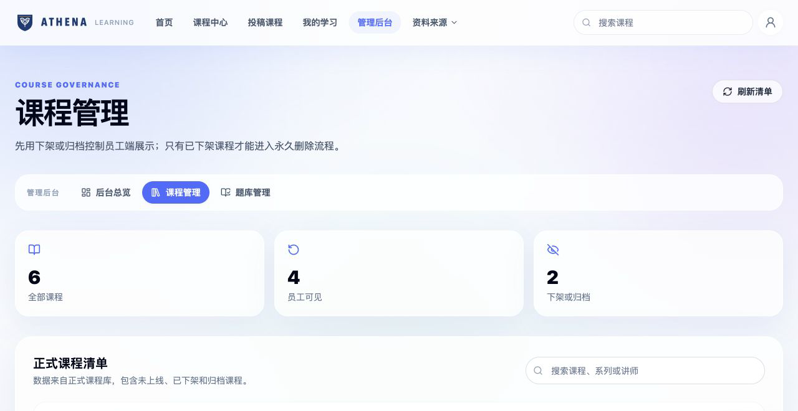
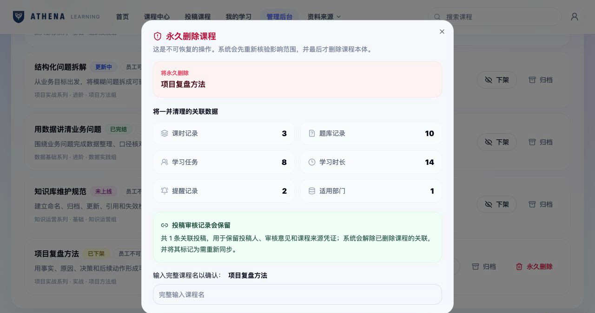

# Athena — 企业学习平台脱敏产品案例

[在线阅读完整案例](https://nafyoung.github.io/ai-academy-miaoda-showcase/) · **真实界面结构 / 合成示例数据 / 不含组织内部资料**



Athena 不是一张课程展示页，而是一套把课程发现、内容投稿、人工审核、学习进度、AI 辅助题库和课程生命周期治理串起来的企业学习平台。

这个仓库是面向招聘者的脱敏产品案例。原实现涉及组织身份、内部课程和私有数据源，因此不公开源代码、配置或 Git 历史；这里用同一套前端界面结构和合成数据，展示我实际解决的问题、关键产品取舍与验证边界。

## 我负责什么

- 将学习者、投稿者、审核者、管理员的需求拆成状态明确的业务流程
- 使用 AI 编程工具辅助前端、后端与测试实现，并对生成代码进行检查和调试
- 设计“投稿 → 人工审核 → 同步预览 → 未上线草稿”的受控内容链路
- 设计 AI 辅助题库：AI 只生成候选题，人负责核对、修改与最终发布
- 设计课程下架、恢复、归档与永久删除预览，避免不可逆误操作
- 区分产品已验证事实、示例展示数据与不能对外宣称的结果

## 核心业务闭环

| 阶段 | 用户要完成的事 | 系统控制点 |
| --- | --- | --- |
| 课程发现 | 查找课程，区分必修与选修 | 分类、来源、部门适用范围与个人任务分开处理 |
| 内容投稿 | 保存草稿，补齐部门、资料与十道题 | 不完整内容可暂存，提交前校验关键字段 |
| 人工审核 | 通过或退回课程与题目 | AI 候选不可直接进入正式题库 |
| 受控同步 | 将审核结果写入课程库 | 同步前预览；课程只创建为“未上线”草稿 |
| 学习追踪 | 查看进度、题目和最近学习动作 | 必修、选修和有效学习时长使用明确口径 |
| 生命周期治理 | 下架、恢复、归档或删除 | 永久删除前重新计算影响并要求精确确认 |

## 关键界面

### 1. 员工端：课程发现与个人学习

课程中心支持分类、来源、个人修读规则、难度和形式筛选；“我的学习”按必修与选修组织个人任务。

| 课程中心 | 我的学习 |
| --- | --- |
|  |  |

### 2. 内容端：投稿、审核与同步

投稿者先保存课程信息，再准备课后题并提交；管理员审核通过后仍需预览和二次确认，才会写入未上线课程草稿。





### 3. AI 辅助题库：候选生成，人工发布

AI 可依据课程资料生成候选题，但题干、选项、答案、解析、知识点和原文依据均需人工核对。保存修改与发布是两个动作。



### 4. 课程治理：优先可逆，删除前看清影响

管理员日常使用下架、恢复和归档。只有已下架课程才能进入永久删除；系统先列出课时、题库、学习任务、学习时长、提醒和适用部门等影响。

| 生命周期清单 | 删除影响预览 |
| --- | --- |
|  |  |

## AI 的使用边界

我没有把“用了 AI”写成“系统能自主运营”。在这个项目里：

- AI 用于辅助开发、生成候选题与提高内容准备效率
- 人工负责需求判断、原文核对、审核、同步确认与发布
- 正式课程目录同步是确定性流程，不调用 AI
- AI 候选题不会自动保存、提交或发布
- 删除、权限与身份等高风险动作由确定性规则控制

## 验证证据

- 原私有实现独立复跑：**19 个测试套件、162 项单测通过**
- 管理员接口具备登录与角色门禁
- 永久删除链路校验课程状态、完整课程名、确认项与预览令牌
- 公开仓库执行文本、路径与常见私有标识扫描
- 截图执行 OCR 检查，禁止真实员工、部门、内部课程、租户链接与应用标识进入公开版本

详细说明见 [验证与公开边界](docs/verification-and-privacy.md)。

## 不能据此宣称什么

- 不宣称已覆盖全体员工或已有真实业务增长指标
- 不宣称 AI 自动运营课程或替代人工审核
- 不宣称已执行真实生产课程删除
- 截图中的课程、人物、部门、数量和时间均为示例，不代表任何组织现状

## 本地查看与检查

案例页本身无第三方前端依赖，常规查看与测试使用 Node.js 22+ 和 Python 3：

```bash
npm run serve
npm test
npm run privacy:check
npm run screenshots:manifest
npm run screenshots:ocr
```

打开 <http://localhost:4173> 查看案例页。

截图 OCR 另需本机已安装的 Tesseract 及 `chi_sim`、`eng` 语言数据。需要排除的组织或资料关键词可在本机通过 `SHOWCASE_PRIVATE_TERMS` 传入，以竖线分隔；不将实际检查词写入公开仓库。当前检查结果见 [截图案例验证记录](docs/testing/showcase-sanitization.tdd.md)。
